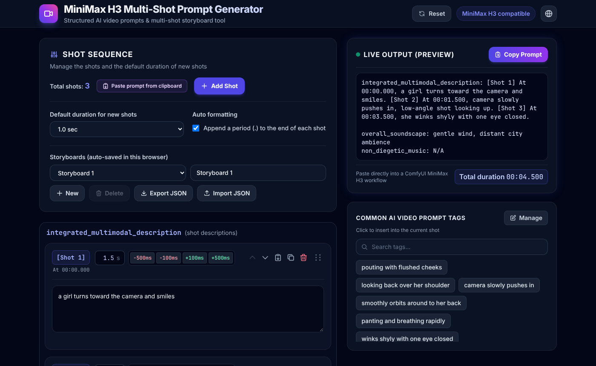

# MiniMax H3 Multi-Shot Prompt Generator

A small browser tool for writing **multi-shot image-to-video prompts** for **MiniMax H3**.
Describe each shot, set its timestamp, and copy a ready-to-paste structured prompt.

### 🚀 [Open the tool](https://blex01000001.github.io/Multi-Shot-Prompt-Generator/)

`https://blex01000001.github.io/Multi-Shot-Prompt-Generator/`

No sign-up, no install. It runs entirely in your browser.



> [!NOTE]
> The output format is designed for **MiniMax H3 image-to-video**.
> It has not been tested with other video models. They may ignore or misread the
> `[Shot N] At MM:SS.mmm` timeline and the field names, so check the results yourself
> before relying on it elsewhere.

## Output format

```
integrated_multimodal_description: [Shot 1] At 00:00.000, a girl turns toward the camera and smiles. [Shot 2] At 00:01.000, camera slowly pushes in, low-angle shot looking up.

overall_soundscape: gentle wind, distant city ambience
non_diegetic_music: N/A
```

- Timestamps use `MM:SS.mmm`.
- Shots with an empty description are left out, and the remaining shots are renumbered.
- Each `At` time is calculated from the durations you enter: the first shot starts at `00:00.000`,
  and each later shot starts when the previous one ends.
- `overall_soundscape` and `non_diegetic_music` default to `N/A`.
- Write prompt text in English. Only the interface is translated.

## How to use

1. Write what happens in each shot (motion, camera work, facial expression, and so on).
2. Set how long each shot lasts (in seconds) by typing or with the `-500ms` / `-100ms` / `+100ms` / `+500ms` buttons.
   Each card shows its start time (`At 00:00.000`), and the preview shows the total duration.
   New shots get the default duration (1 s unless you change it).
3. Optionally fill in the ambient sound and background music.
4. Click **Copy Prompt** and paste the result into MiniMax H3, for example a ComfyUI MiniMax H3 workflow.

## Features

- **Shot editing**: add, duplicate, delete, move up and down, or drag to reorder
  (each shot keeps its duration, and the start times are recalculated).
- **Paste prompt from clipboard**: turn an existing MiniMax H3 prompt back into shot cards
  (durations come from the gaps between the `At` times, and the last shot gets the default duration;
  asks first if the cards already have content; falls back to a paste box if the browser blocks the clipboard).
- **Paste into a shot**: the clipboard button on each card pastes plain text into that shot's description,
  joining line breaks and extra spaces into single spaces (asks first if the shot already has text).
- **Duration check**: highlights durations that are not a number of seconds greater than 0.
- **Auto formatting**: optionally adds a period to the end of each shot.
- **Prompt tags**: search and click common phrases to insert them into the current shot.
  Add, edit, delete, drag to reorder, and import or export your own tags as JSON.
- **Several storyboards**: create, switch, rename, and delete saved storyboards, and export or import one (shots, soundscape, music) as JSON.
- **Languages**: English, 繁體中文, and 日本語 (globe icon, top right).
- **Desktop and mobile** layouts.

Your tags, language choice, and storyboards (shots, soundscape, music) are saved
automatically in the browser (`localStorage`), so reloading the page keeps them.

## Run it locally

There is no build step. Download or clone the repository and open `index.html` in a browser.
Keep `index.html`, `css/`, and `js/` together.

```bash
git clone https://github.com/Blex01000001/Multi-Shot-Prompt-Generator.git
```

An internet connection is needed: Tailwind CSS, SortableJS, and the fonts load from CDNs.

## Development

`npm` is only used for tests:

```bash
npm install
```

```bash
npm run test:all
```

See [`CLAUDE.md`](CLAUDE.md) for the file layout and contribution rules.
